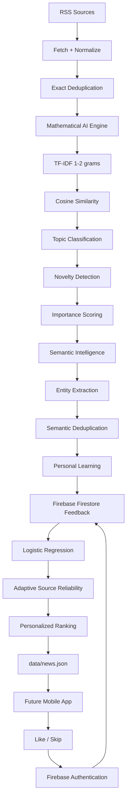

# NewsBrief AI

A personal AI-assisted news briefing system focused on **important Malayalam/general news** and **technology news**.

The project reduces information overload by collecting news automatically, removing duplicates, analysing importance, learning from user feedback, and producing a ranked feed for a future mobile app.

## Architecture

The architecture is shown as connected processing boxes so the data flow is explicit:



### Pipeline

```text
RSS Sources
     │
     ▼
┌──────────────────────┐
│ Fetch + Normalize    │
└──────────┬───────────┘
           │
           ▼
┌──────────────────────┐
│ Exact Deduplication  │
└──────────┬───────────┘
           │
           ▼
┌──────────────────────┐
│ Mathematical AI      │
│ • TF-IDF 1–2 grams   │
│ • Cosine similarity  │
│ • Classification     │
│ • Novelty            │
│ • Importance         │
└──────────┬───────────┘
           │
           ▼
┌──────────────────────┐
│ Semantic Intelligence│
│ • Entity extraction  │
│ • Semantic dedup     │
└──────────┬───────────┘
           │
           ▼
┌────────────────────────────┐
│ Personal Learning          │
│ • Firestore feedback       │
│ • Logistic Regression      │
│ • Source reliability       │
└────────────┬───────────────┘
             │
             ▼
┌──────────────────────┐
│ Personalized Ranking │
└──────────┬───────────┘
           │
           ▼
┌──────────────────────┐
│ data/news.json       │
└──────────┬───────────┘
           │
           ▼
┌──────────────────────┐
│ Future Mobile App    │
└──────────┬───────────┘
           │
       Like / Skip
           │
           ▼
┌──────────────────────┐
│ Firebase Auth +      │
│ Firestore            │
└──────────┬───────────┘
           │
           └──────────────► Personal Learning
```

## AI / Machine Learning

NewsBrief AI starts with transparent, lightweight mathematical methods rather than a hosted LLM. This keeps the core pipeline inexpensive and suitable for GitHub Actions.

### TF-IDF with 1–2 grams

Article text is converted into numerical features using unigrams and bigrams. This captures individual terms and useful phrases such as `artificial intelligence` and `open source`.

### Cosine similarity and novelty

Cosine similarity measures how closely stories are related. Novelty scoring uses this signal to identify repetitive versus distinct stories.

### Topic classification

A mathematical prototype classifier estimates whether an article is `general` or `tech`, using the feed category as a small prior.

### Importance scoring

Importance combines important-event signals, topic relevance, source quality, and recency.

## Personal Intelligence

### Personal classifier

`src/learning.py` trains a **Logistic Regression** classifier from `like` and `skip` feedback after enough examples from both classes exist. It uses TF-IDF 1–2 gram features and produces a personal relevance score.

Until there is enough feedback, the deterministic ranking system remains active. This avoids overfitting a tiny personal dataset.

### Adaptive source reliability

Source reliability is estimated from historical feedback using Bayesian smoothing. A source therefore becomes more or less influential gradually rather than changing drastically after one interaction.

### Entity extraction

`src/entity_extractor.py` extracts English and Malayalam entity candidates using lightweight Unicode-aware rules. These entities can support topic clustering, entity pages, and personalization.

### Semantic deduplication

`src/semantic_dedup.py` supports embedding-based duplicate detection with `sentence-transformers` and `all-MiniLM-L6-v2`. A similarity threshold of `0.88` flags near-duplicate stories.

The embedding dependency is intentionally optional because downloading a transformer model on every GitHub Actions run would significantly increase build time. When it is unavailable, exact/title deduplication and TF-IDF similarity remain the fallback.

## Firebase Feedback

Firebase is used only as the feedback store for the personal learning loop. News collection and ML processing remain in GitHub Actions.

### Authentication

The mobile app uses **Firebase Anonymous Authentication**, so users can submit feedback without creating a login account. Firestore rules require authentication and validate feedback fields.

### Firestore collection

Feedback is stored in the `feedback` collection. A feedback document can contain:

```json
{
  "article_id": "example-001",
  "action": "like",
  "title": "Example article title",
  "summary": "Short article summary",
  "category": "tech",
  "source": "Example Source",
  "timestamp": "server timestamp"
}
```

`action` is restricted to `like` or `skip` by the Firestore security rules.

### GitHub Actions integration

The workflow authenticates to Google Cloud using the GitHub Actions secret:

```text
FIREBASE_SERVICE_ACCOUNT_JSON
```

The private service-account JSON is **not stored in the repository**. GitHub Actions obtains a temporary access token, runs `src/sync_feedback.py`, and loads the Firestore feedback into the temporary `data/feedback.json` file used by the ML pipeline.

The feedback file is not committed back to the repository. This keeps personal feedback out of the public news feed repository.

## Project Structure

```text
newsbrief-ai/
├── .github/
│   └── workflows/
│       └── news.yml
├── config/
│   └── sources.json
├── data/
│   ├── news.json
│   └── feedback.json
├── src/
│   ├── ai_engine.py
│   ├── entity_extractor.py
│   ├── fetch_news.py
│   ├── learning.py
│   ├── semantic_dedup.py
│   └── sync_feedback.py
├── .gitignore
├── requirements.txt
└── README.md
```

## Personal Learning Flow


## Run Locally

```bash
python -m venv .venv
source .venv/bin/activate
pip install -r requirements.txt
python src/fetch_news.py
```

The generated feed is written to `data/news.json`.

For optional embedding-based semantic deduplication:

```bash
pip install sentence-transformers
```

The Firestore feedback sync is intended for GitHub Actions. Local execution of `src/sync_feedback.py` requires Google Cloud credentials and the corresponding environment variables.

## GitHub Actions

The workflow checks out the repository, installs dependencies, authenticates to Google Cloud, obtains a temporary Firestore access token, syncs feedback, fetches RSS feeds, runs the AI and personal-learning pipeline, validates `data/news.json`, and commits only the generated news feed.

It supports manual execution and is scheduled every **30 minutes**.

The workflow uses the repository secret `FIREBASE_SERVICE_ACCOUNT_JSON`. The secret must never be committed to the repository.

## News Sources

Sources are configured in `config/sources.json` and currently cover:

- Kerala
- India
- World
- Science
- Artificial Intelligence
- Software Development
- Cybersecurity
- Open Source
- Android

## Data Model

Original source information is preserved while AI-derived information is stored separately.

Example AI fields:

```json
{
  "ai_category": "tech",
  "ai_confidence": 0.82,
  "ai_importance": 8,
  "ai_novelty": 0.71,
  "entities": ["Example Entity"],
  "source_reliability": 1.02,
  "personal_model_score": 0.64,
  "personal_score": 9.28
}
```

## Roadmap

### Phase 1 — Collection

- [x] RSS collection
- [x] Text normalization
- [x] URL/title deduplication
- [x] Automated GitHub Actions execution

### Phase 2 — Mathematical AI

- [x] TF-IDF vectorization
- [x] 1–2 gram features
- [x] Cosine similarity
- [x] Topic classification
- [x] Novelty detection
- [x] Importance ranking

### Phase 2.5 — Personal Intelligence

- [x] Firebase Firestore feedback storage
- [x] Firebase Anonymous Authentication
- [x] GitHub Actions Firestore feedback sync
- [x] Personal Logistic Regression classifier
- [x] Adaptive source reliability
- [x] Lightweight Malayalam/English entity extraction
- [x] Optional embedding-based semantic deduplication
- [ ] Mobile feedback submission
- [ ] Larger feedback evaluation dataset
- [ ] Ranking calibration and offline evaluation

### Phase 3 — Language Intelligence

Future versions may add a small local language model for Malayalam titles, summaries, detailed summaries, stronger multilingual understanding, and advanced entity linking.

The language model will remain separate from the mathematical ranking layer.

### Phase 4 — Mobile Delivery

- [ ] Mobile application
- [ ] General/Malayalam news tab
- [ ] Technology news tab
- [ ] News images
- [ ] Source links
- [ ] Offline/cache support
- [ ] User feedback controls
- [ ] Optional notifications

## Design Goal

The goal is **not to collect more news**. It is to identify a small number of useful stories while preserving the original source for verification.

The project combines explainable mathematical ranking with progressively learned personal preferences. Larger AI models are optional rather than fundamental to the architecture.
