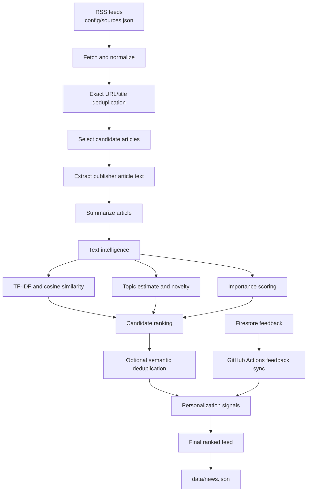

# NewsBrief AI

**A personal news-intelligence pipeline for Malayalam/general news and technology news.**

NewsBrief AI collects stories from configured RSS feeds, normalizes and deduplicates them, extracts and summarizes article content where available, scores stories, and publishes a ranked JSON feed. An optional feedback loop uses Firebase Firestore and a lightweight machine-learning model to personalize relevance.

> **Project status:** The repository currently contains the automated Python feed pipeline and feedback-learning components. The mobile application described in the roadmap is planned work, not part of the current pipeline.

## What it does

- Collects news from configurable RSS sources covering Kerala, India, world news, science, AI, software development, cybersecurity, open source, and Android.
- Normalizes article titles and URLs and removes exact duplicates.
- Attempts to extract readable publisher article text and summarizes it with an optional OpenAI API integration or an extractive fallback.
- Computes TF-IDF-based text features, similarity, topic estimates, novelty signals, and importance scores.
- Optionally detects near-duplicate stories with sentence-transformers embeddings.
- Syncs user feedback from Firestore and uses like/skip signals to personalize ranking when enough examples are available.
- Writes the generated feed to `data/news.json`.

## Architecture



GitHub Actions orchestrates the scheduled or manual run. It installs dependencies, authenticates to Google Cloud to sync feedback, runs the feed pipeline, validates the generated JSON, and commits changes to `data/news.json`.

For the detailed data flow, module responsibilities, and design trade-offs, see [Architecture and data flow](docs/architecture.md).

## Technology stack

- **Language:** Python 3.10+ (the GitHub Actions workflow uses Python 3.12)
- **Ingestion:** RSS with `feedparser`, HTTP requests with `requests`
- **Parsing:** Beautiful Soup and `python-dateutil`
- **Text ranking:** scikit-learn TF-IDF and logistic regression
- **Feedback storage:** Firebase Firestore
- **Optional summarization:** OpenAI API, configured through environment variables
- **Automation:** GitHub Actions

## Project structure

```text
newsbrief-ai/
├── .github/
│   └── workflows/
│       └── news.yml           # Scheduled/manual pipeline workflow
├── config/
│   └── sources.json           # RSS feed configuration
├── data/
│   ├── news.json              # Generated feed
│   └── feedback.json          # Runtime feedback data; do not publish user feedback
├── src/
│   ├── fetch_news.py          # Pipeline orchestration and feed generation
│   ├── article_extractor.py   # Publisher-page article extraction
│   ├── summarizer.py          # LLM and extractive summary paths
│   ├── ai_engine.py           # TF-IDF features, classification, novelty, importance
│   ├── semantic_dedup.py      # Optional embedding-based duplicate detection
│   ├── entity_extractor.py    # Lightweight Malayalam/English entity candidates
│   ├── learning.py            # Feedback-based classifier and source signals
│   └── sync_feedback.py       # Firestore feedback synchronization
├── requirements.txt
└── README.md
```

## Run locally

### Prerequisites

- Python 3.10 or newer
- Network access to the configured RSS feeds
- Optional credentials for integrations described below

### 1. Clone and install

```bash
git clone https://github.com/muhammedshibilm/newsbrief-ai.git
cd newsbrief-ai

python -m venv .venv
source .venv/bin/activate
python -m pip install --upgrade pip
python -m pip install -r requirements.txt
```

On Windows PowerShell, activate the environment with:

```powershell
.venv\Scripts\Activate.ps1
```

### 2. Run the pipeline

```bash
python src/fetch_news.py
```

The pipeline is expected to write its feed to `data/news.json`. Inspect the logs if a feed or publisher page cannot be reached; availability and article-extraction quality depend on external sites.

### Optional integrations

**OpenAI summarization:** Set `OPENAI_API_KEY` to enable the API-backed summary path. `OPENAI_MODEL` can override the model configured by the code. Without a usable API-backed summary, the summarizer can fall back to extractive summarization or RSS-provided text.

**Semantic deduplication:** Install `sentence-transformers` if you want to enable the optional embedding-based duplicate-detection path:

```bash
python -m pip install sentence-transformers
```

**Firestore feedback sync:** `src/sync_feedback.py` needs Google Cloud credentials and the environment variables expected by that module. The automated workflow configures authentication for this step. Do not commit service-account credentials or user feedback.

## GitHub Actions

The workflow is defined in [`.github/workflows/news.yml`](.github/workflows/news.yml).

- **Trigger:** manual dispatch or an hourly schedule at minute 0 (`0 */1 * * *`).
- **Runtime:** Ubuntu runner with Python 3.12.
- **Feedback:** authenticates to Google Cloud and syncs Firestore feedback before collecting news.
- **Validation:** parses `data/news.json` with Python's JSON tool.
- **Publishing:** commits the generated feed only when the file has changed.

The workflow expects the repository secret `FIREBASE_SERVICE_ACCOUNT_JSON`. The OpenAI summarization key is supplied through the optional `OPENAI_API_KEY` secret. Configure the `OPENAI_MODEL` repository variable if you need to select a specific model. Never put API keys, service-account JSON, or other credentials in source control.

## How personalization works

The feedback loop uses `like` and `skip` actions synced from Firestore. The classifier in `src/learning.py` uses TF-IDF features and logistic regression, and only trains when it has enough labelled examples from both classes. Before that threshold is met, the pipeline can continue using its non-personalized ranking signals.

Source-reliability estimates use Bayesian smoothing so a small number of interactions does not cause an extreme shift. See [Architecture and data flow](docs/architecture.md) for further detail.

## Limitations

- Feed availability, publication timestamps, article extraction, and RSS summaries depend on external publishers and services.
- The TF-IDF topic classifier is a lightweight heuristic/prototype, not a trained general-purpose language understanding model.
- Personalization quality depends on the quantity and representativeness of feedback. It should be evaluated with a larger dataset before making strong claims about recommendation quality.
- Embedding-based semantic deduplication is optional and may be skipped when its dependency/model is unavailable.
- The mobile app and its user-facing feedback interface remain roadmap items.

## Roadmap

- [x] RSS ingestion and URL/title deduplication
- [x] TF-IDF-based text signals and importance ranking
- [x] Firestore feedback synchronization
- [x] Feedback-based logistic-regression classifier
- [x] Optional embedding-based semantic deduplication
- [ ] Automated unit tests and ranking evaluation
- [ ] Better monitoring and clearer pipeline failure reporting
- [ ] Larger feedback evaluation dataset and ranking calibration
- [ ] Mobile app with article browsing and like/skip feedback
- [ ] Offline/cache support and optional notifications

## Design goal

The goal is not to collect the largest possible number of stories. It is to surface a smaller, more useful selection while preserving source links so readers can verify the original reporting.

## License

See [LICENSE](LICENSE).
