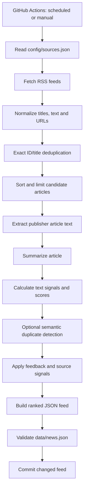

# Architecture and Data Flow

This document describes the current NewsBrief AI pipeline based on the repository code. It separates the automated feed-generation path from the optional feedback-learning loop and the future mobile-app roadmap.

## 1. System context

The pipeline is run by GitHub Actions, either manually or on its hourly schedule. It reads feed configuration from `config/sources.json`, fetches RSS entries, processes a bounded set of candidates, and writes a JSON feed to `data/news.json`.

External dependencies can fail independently: RSS providers may be unavailable, publisher pages may block extraction, optional model dependencies may not be installed, and API credentials may be missing or invalid. The code includes fallback paths for some of these cases; these should not be interpreted as a guarantee that every source will always be processed successfully.

## 2. Main pipeline



### Stage responsibilities

| Stage | Responsibility | Code |
| --- | --- | --- |
| Configuration | Defines general and technology RSS sources | `config/sources.json` |
| Fetching and normalization | Retrieves RSS entries, cleans text, normalizes URLs, derives stable IDs and parses publication dates | `src/fetch_news.py` |
| Exact deduplication | Removes duplicate IDs and normalized titles | `src/fetch_news.py` |
| Article extraction | Attempts to extract the publisher's main article text using JSON-LD and HTML structure | `src/article_extractor.py` |
| Summarization | Uses the configured OpenAI API when available, otherwise attempts extractive summarization or falls back to RSS text/title | `src/summarizer.py` |
| Text intelligence | Computes TF-IDF-based similarity, a lightweight topic estimate, novelty and importance signals | `src/ai_engine.py` |
| Semantic deduplication | Optionally uses sentence-transformers embeddings to flag near-duplicate stories | `src/semantic_dedup.py` |
| Entity candidates | Extracts English and Malayalam entity candidates with lightweight rules | `src/entity_extractor.py` |
| Personalization | Trains a logistic-regression model when enough feedback is available and estimates source-level signals | `src/learning.py` |
| Feedback synchronization | Reads feedback from Firestore for use by the pipeline | `src/sync_feedback.py` |
| Orchestration and publishing | Installs dependencies, authenticates, runs the pipeline, validates JSON, and commits changed output | `.github/workflows/news.yml` |

## 3. Ranking and machine-learning signals

NewsBrief AI combines several different types of signals. They are not all generated by a single model.

- **TF-IDF and cosine similarity:** represent text with unigram/bigram features and estimate textual similarity.
- **Topic estimate:** a lightweight lexical similarity prototype estimates whether a story is general or technology-related. It is not a large pretrained classifier.
- **Novelty:** uses similarity to other candidate stories as one signal for how distinct an article appears.
- **Importance:** uses configured keyword weights, source hints, topic-related signals, and recency.
- **Semantic deduplication:** when its optional dependency and model are available, embedding similarity can flag near-duplicate candidates.
- **Personal relevance:** logistic regression is trained from like/skip feedback only after the minimum number and balance of examples are met.
- **Source reliability:** feedback-derived estimates use smoothing to avoid large swings from a small number of interactions.

These signals support ranking; they do not prove that a story is factually correct or objectively important. Ranking quality should be assessed with a representative evaluation dataset.

## 4. Feedback loop


The feedback integration is designed for the future reader experience. The current repository includes the backend synchronization and learning logic; the mobile application and its user-facing feedback interface are roadmap work.

Feedback is personal data. Keep credentials out of Git and avoid publishing raw feedback. Review Firestore rules and repository ignore/commit behaviour before deploying this flow for multiple users.

## 5. Runtime and deployment

The workflow in `.github/workflows/news.yml`:

1. Starts on manual dispatch or hourly at minute zero.
2. Checks out the repository and configures Python 3.12.
3. Installs pinned dependencies from `requirements.txt`.
4. Authenticates to Google Cloud using the `FIREBASE_SERVICE_ACCOUNT_JSON` repository secret.
5. Obtains a temporary access token and synchronizes feedback.
6. Runs `src/fetch_news.py`, passing the optional `OPENAI_API_KEY` secret and `OPENAI_MODEL` repository variable.
7. Validates `data/news.json` as JSON.
8. Commits the generated feed only when it changed.

The workflow has write permission to repository contents because it publishes generated feed changes. Treat any change to its permissions, secrets, or commit logic as a security-sensitive change.

## 6. Local development

Create a virtual environment, install `requirements.txt`, and run:

```bash
python src/fetch_news.py
```

The feed configuration is in `config/sources.json`. OpenAI summarization and embedding-based semantic deduplication are optional integrations. Firestore feedback synchronization requires the credentials and environment variables expected by `src/sync_feedback.py`.

For a local run, inspect logs and the generated `data/news.json`. External feed availability and publisher-page structure can change, so a successful run on one day does not guarantee that all sources will remain available.

## 7. Current boundaries and future work

### Implemented in the repository

- RSS collection, normalization, and exact duplicate filtering
- Article extraction and summary fallbacks
- Lightweight text-based classification, similarity, novelty, and importance signals
- Optional embedding-based semantic duplicate detection
- Firestore feedback synchronization and feedback-derived ranking signals
- Scheduled/manual GitHub Actions feed generation and JSON validation

### Planned or needing stronger validation

- Mobile UI and user-facing like/skip feedback
- Automated unit and integration tests
- Offline evaluation of ranking quality and calibration
- Operational monitoring and structured failure reporting
- Larger, representative feedback datasets

The architecture should evolve alongside the implementation. Update this document when pipeline stages, output contracts, secrets, or workflow behaviour change.
